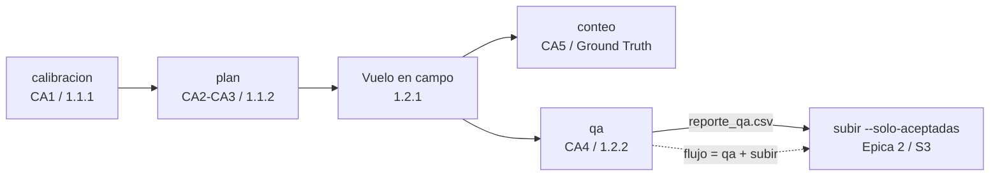
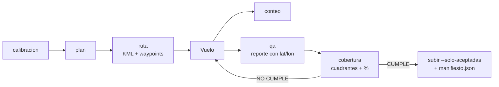

# AgroDron: plan de mejoras y cómo funciona el script

Script: `agrodron_sprint1_epica1_v3.py` (se mantiene el mismo nombre por el hallazgo **H5**: una sola versión)
Pruebas: `test_agrodron.py` (de 7 a **39 pruebas**, todas pasan)
Fuente de requisitos: `Entregable_Sprint1_Epica1_AgroDron_v3.docx`

---

## 1. Cómo funciona (visión general)

El script cubre en orden las tareas de la Épica 1 y deja listas las fotos para la Épica 2 (S3). Cada paso es un subcomando:



| Paso | Comando | Qué hace | Criterio |
|---|---|---|---|
| 1 | `calibracion` | Revisa la bitácora: satélites ≥ 16, obturación ≤ 1/1000 s y avisa si el HDOP es mayor a 1,0 | CA1 |
| 2 | `plan` | Calcula GSD, huella, pasos, líneas, fotos, intervalo de disparo, **distancia, tiempo de vuelo y baterías**. Si no le pasas la altura, usa la **recomendada (25 m)** | CA2, CA3 (H1) |
| 3 | `conteo` | Lee la planilla de campo (CSV) y calcula la diferencia por cuadrante y en total | CA5 |
| 4 | `qa` | Revisa cada foto: tamaño, si está corrupta, resolución 4000×3000, nitidez ≥ 120 (Laplaciano) y GPS con lat/lon | CA4 |
| 5 | `subir` | Sube a `raw/<finca>/<lote>/<fecha>/...` con MD5 y cifrado AES256. **Por defecto solo simula** | Épica 2 |
| 4+5 | `flujo` | Hace la auditoría y sube solo las fotos aceptadas, en un solo paso | CA4 + Épica 2 |
| — | `ruta` | Exporta la ruta de vuelo a **KML** y un **CSV de waypoints** (fase 7) | CA2 |
| — | `cobertura` | Cuenta las fotos aceptadas **por cuadrante según su GPS** y el **% de la parcela cubierto** (fases 6 y 8) | CA2, CA4 |

### Códigos de salida (útiles para automatizar)
- `0` = todo bien
- `1` = no cumple (GSD, calibración) o hubo errores al subir
- `2` = error de entrada (carpeta que no existe, fecha mal escrita, finca/lote con caracteres no válidos)

---

## 2. Fases realizadas

### Fase 1: Correcciones (bugs) ✅
| # | Problema en v3 original | Corrección |
|---|---|---|
| 1 | `cv2.imread` falla en Windows con rutas que tienen tildes o ñ (ej. *Vereda La Cabaña*) y marcaba fotos buenas como **CORRUPTA** | Se lee el archivo con `np.fromfile` + `cv2.imdecode` (`leer_gris`) |
| 2 | `tiene_gps` aceptaba un bloque GPS **vacío o sin coordenadas** | Ahora exige latitud y longitud (etiquetas 2 y 4) |
| 3 | `subir_lote` se caía con `FileNotFoundError` si la carpeta no existía | Se valida antes y sale un mensaje claro |
| 4 | Si fallaba **una** subida (red, permisos), se caía **todo el lote** | Cada foto atrapa su error → estado `ERROR` con el motivo y las demás siguen |
| 5 | `finca`, `lote` y `fecha` no se validaban (se podían crear claves S3 como `raw/../x`) | `validar_destino`: solo `[A-Za-z0-9_-]` y fecha `AAAA-MM-DD` |
| 6 | `subir` subía **todas** las fotos, también las rechazadas por QA | `--solo-aceptadas reporte_qa.csv` y el comando `flujo` |
| 7 | `plan` solo aceptaba `--altura`; el resto de parámetros estaban fijos | Ahora acepta `--ancho --largo --solape-frontal --solape-lateral --velocidad --autonomia` |
| 8 | Los comandos siempre salían con código 0 | Códigos de salida 0/1/2 |
| 9 | Valor por defecto `cam=Camara()` repetido en cada función | Constante `CAMARA` compartida |

### Fase 2: Funciones nuevas sacadas del entregable ✅
| Función | Por qué (según el docx) |
|---|---|
| `validar_calibracion` + comando `calibracion` | CA1 pedía ≥ 16 satélites y 1/1000 s, pero el script no lo revisaba |
| `altura_recomendada()` | Hallazgo **H1** y la retrospectiva ("calcular el GSD **antes** de volar"). Da 25 m (máxima 26,67 m con 5 % de margen) |
| `distancia_m`, `tiempo_vuelo_min`, `baterias` en el plan | En campo se usaron 2 baterías; ahora se sabe antes de volar cuántas hacen falta |
| `comparar_conteo` + comando `conteo` | CA5 / sección 6: calcula −148 (−5,92 %) a partir de la planilla |
| `qa --recursivo` con resumen `por_grupo` | Las fotos se organizan por cuadrante Q1–Q4 ("35 por cuadrante") |
| `nitidez_promedio_aceptadas` | El docx reporta un "índice promedio 244,8" |
| Auditoría en paralelo (`--hilos`) | 148 fotos de 12 MP: se procesan más rápido |
| Subida idempotente (`YA_EXISTE`) | Si se vuelve a correr, no se suben otra vez fotos idénticas (compara ETag con MD5) |
| `--json` en `plan`, `qa` y `conteo` | Para conectar con otras herramientas o épicas |
| `requirements.txt` | Para instalar todo con un solo comando |

### Fase 3: Pruebas ✅
De 7 a 24 pruebas. Las nuevas cubren calibración, altura recomendada, tiempo y baterías, conteo con los datos reales del docx (2.352 / −5,92 % / Q3 −7,36 %), rutas con ñ, GPS vacío, auditoría por cuadrante, validación de destino, `--solo-aceptadas`, subida real con un **cliente S3 falso** (`YA_EXISTE`, `SUBIDO`) y errores de red que no detienen el lote.

---

## 3. Cómo usarlo

```powershell
# Instalar (una vez)
python -m venv .venv
.venv\Scripts\pip install -r requirements.txt

# 1. Calibración (datos de la bitácora del 20/10)
python agrodron_sprint1_epica1_v3.py calibracion --satelites 18 --obturacion 1/1000 --hdop 0.68

# 2. Plan de vuelo (sin --altura usa la recomendada de 25 m)
python agrodron_sprint1_epica1_v3.py plan
python agrodron_sprint1_epica1_v3.py plan --altura 30      # avisa que NO cumple y sale con 1

# 3. Conteo de referencia (CSV: cuadrante,esperadas,conteo)
python agrodron_sprint1_epica1_v3.py conteo planilla_conteo.csv

# 4. Auditoría (con subcarpetas Q1..Q4)
python agrodron_sprint1_epica1_v3.py qa fotos_sd --recursivo --reporte reporte_qa.csv

# 5. Subir solo las aceptadas (simulación; agrega --real para subir de verdad)
python agrodron_sprint1_epica1_v3.py subir fotos_sd --finca cabana --lote piloto --fecha 2026-10-22 --solo-aceptadas reporte_qa.csv

# 4+5 en un solo paso
python agrodron_sprint1_epica1_v3.py flujo fotos_sd --recursivo --finca cabana --lote piloto --fecha 2026-10-22

# Pruebas
python -m unittest test_agrodron -v
```

Variables de entorno para AWS: `AGRODRON_BUCKET`, `AGRODRON_REGION` (y las credenciales normales de boto3).

---

## 4. Fases de la segunda ronda

| Fase | Mejora | Estado |
|---|---|---|
| 4 | Correr `qa` sobre las **148 fotos reales** para confirmar el 140/8 | ⏳ **Pendiente (tuyo)**: las fotos no están en la carpeta. El comando ya está listo (ver abajo) |
| 5 | Decisión de **H1**: volver a volar a 25 m o cambiar el requisito | ⏳ **Pendiente (Scrum Master + cliente)**. Para re-volar ya hay ruta KML a 25 m (fase 7) |
| 6 | Cuadrante por **coordenadas GPS** del EXIF | ✅ Hecho |
| 7 | Exportar la ruta como **KML + CSV de waypoints** | ✅ Hecho |
| 8 | **Cobertura real** de la parcela con las fotos aceptadas | ✅ Hecho |
| 9 | Subida **multiparte** + **manifiesto JSON** del lote en S3 | ✅ Hecho |
| 10 | Corregir en el roadmap **H3** y **H4** | ⏳ **Pendiente (Scrum Master)**: es el roadmap, no el código |

### Fase 6: cuadrantes por GPS ✅
- `leer_gps()` convierte el EXIF (grados, minutos, segundos y N/S/E/W) a grados decimales. Por ejemplo, 5°3′ N, 75°30′ W pasa a (5,05, −75,5).
- El reporte `qa` ahora trae las columnas **`lat` y `lon`** de cada foto.
- `Parcela` modela el lote: la esquina de origen (`--lat --lon`), `--ancho`, `--largo` y el `--rumbo` de las líneas de vuelo. Convierte metros ↔ coordenadas.
- `asignar_cuadrante()` divide la parcela por sus **diagonales** en Q1 Norte, Q2 Este, Q3 Sur y Q4 Oeste (cada uno de 2.500 m², como en el entregable). Las fotos fuera del lote quedan como `FUERA`.

### Fase 7: ruta de vuelo exportable ✅
- `generar_ruta()` arma el recorrido en "cortacésped": las líneas centradas en la parcela, con el sentido alternado y el inicio y fin de cada línea como waypoint. A 25 m salen 12 líneas y **24 waypoints**.
- El comando `ruta` escribe:
  - **`ruta_vuelo.kml`**: el polígono de la parcela, la línea de la ruta y los waypoints con altura relativa al terreno. Se abre en Google Earth o en software de vuelo.
  - **`ruta_vuelo_waypoints.csv`**: latitud, longitud, altura y velocidad, para importar en apps de misión.
- `--rumbo` permite alinear las líneas con el viento dominante (el entregable dice "líneas paralelas al viento", del NE, así que serían unos 45°).

### Fase 8: cobertura real (evidencia de CA2) ✅
- `calcular_cobertura()` dibuja la **huella** de cada foto aceptada (37,5 × 28,1 m a 25 m) sobre una rejilla de 1 m de la parcela y calcula qué porcentaje quedó cubierto.
- El comando `cobertura` lee el reporte de `qa` y muestra las fotos por cuadrante, la cobertura en % y si **CUMPLE** (100 %) o no. Si no cumple, sale con código 1.
- Sirve para saber, antes de salir del campo, si los descartes (por ejemplo las 8 borrosas) dejaron huecos.

### Fase 9: carga robusta a S3 ✅
- Los archivos de **16 MB o más** se suben por partes con `upload_file` (boto3 parte el archivo y reintenta cada parte).
- Cada objeto guarda su **MD5 en los metadatos**, porque en multiparte el ETag no es el MD5. Así la detección de `YA_EXISTE` sigue funcionando.
- **Manifiesto** (`crear_manifiesto`): finca, lote, fecha, bucket, totales por estado, bytes y la lista de archivos con su MD5.
  - Con `--real` se sube como `raw/<finca>/<lote>/<fecha>/manifiesto.json`.
  - Con `--manifiesto archivo.json` también se guarda en tu equipo (sirve en simulación).

### Fase 10: Simulador completo de campo, fotos sintéticas y panel interactivo con mapa + dron (`demo`) ✅
Como es un proyecto académico y necesitas mostrar todo funcionando de punta a punta con fotos, mapa y animación del dron, se añadió [`simulador_agrodron.py`](file:///c:/Users/anton/Downloads/pp/simulador_agrodron.py) y el subcomando `demo`:
- **Terreno y cultivo sintético (100 m × 100 m)**: genera las 2.500 posiciones de siembra y las **2.352 plantas vivas** exactas del entregable (Q1: 598, Q2: 584, Q3: 579, Q4: 591), más un **ortomosaico (`ortomosaico.jpg`)** con las diagonales de los cuadrantes.
- **Fotos reales `.jpg` (4000×3000) con EXIF GPS**: recorta la huella que ve la cámara del dron en cada disparo, las organiza en `fotos_sd/Q1..Q4` e inyecta fotos borrosas en los giros de cabecera tal como reporta el entregable.
- **Pipeline completo automático**: ejecuta calibración (`CA1`), plan de vuelo comparando 30 m vs 25 m (`CA2/CA3`), ruta KML + waypoints CSV, planilla de conteo (`CA5`), auditoría QA (`CA4` → `reporte_qa.csv`), cálculo de cobertura y simulación S3 con `manifiesto.json`.
- **Panel interactivo (`panel_agrodron.html`)**:
  - **Mapa satelital interactivo (Leaflet)** + **vista cenital en lienzo offline** con la parcela, las líneas de vuelo y los disparos.
  - **Animación del dron en vivo** (Play/Pausa, paso a paso, control de velocidad) mostrando la huella de la cámara sobre el terreno.
  - **Visor de cámara y telemetría en tiempo real**: miniatura de la foto tomada, nitidez Laplaciana, coordenadas GPS, cuadrante y dictamen (`ACEPTADA` / `RECHAZADA`).
  - **Galería filtrable** (Todas / Aceptadas / Borrosas), tabla comparativa del Hallazgo H1 (30 m vs 25 m), tabla Ground Truth y resumen del lote S3.

### Pruebas ✅
De 24 a **41 pruebas**. Las nuevas cubren: lectura de coordenadas, conversión ida y vuelta con distintos rumbos, cuadrantes (también con la parcela girada), waypoints y KML válido, aviso de altura en `ruta`, cobertura del 100 % con el plan completo y menor al 60 % si faltan líneas, cobertura desde un reporte, multiparte, `YA_EXISTE` por metadatos, manifiesto y generación completa del simulador (`demo`).

---

## 5. Flujo completo actualizado



```powershell
# OPCIÓN RECOMENDADA: Generar todo el proyecto (cultivo, fotos con GPS, QA, S3 y abrir el mapa con el dron)
.venv\Scripts\python agrodron_sprint1_epica1_v3.py demo

# (Opcional) Si quieres simular las 148 fotos exactas con 8 borrosas del entregable:
.venv\Scripts\python agrodron_sprint1_epica1_v3.py demo --fotos 148 --descartadas 8

# Ruta para el re-vuelo a 25 m (origen = esquina SO del lote en Vereda La Cabaña, lineas al NE)
.venv\Scripts\python agrodron_sprint1_epica1_v3.py ruta --lat 5.0949 --lon -75.5891 --rumbo 45 --salida ruta_vuelo.kml

# Fase 4: auditar las 148 fotos reales de la microSD
python agrodron_sprint1_epica1_v3.py qa fotos_sd --recursivo --reporte reporte_qa.csv

# Cuadrantes y cobertura con las fotos aceptadas (misma parcela que la ruta)
python agrodron_sprint1_epica1_v3.py cobertura reporte_qa.csv --lat 5.0949 --lon -75.5891 --rumbo 45

# Subir con manifiesto
python agrodron_sprint1_epica1_v3.py subir fotos_sd --finca cabana --lote piloto --fecha 2026-10-22 --solo-aceptadas reporte_qa.csv --manifiesto manifiesto.json
```

> [!IMPORTANT]
> Las coordenadas por defecto (`5.0949, -75.5891` — 5°05′42″ N, 75°35′21″ W, ~1.417 msnm) ubican el lote directamente en la **zona rural agrícola de la Vereda La Cabaña** al noroccidente de Manizales.

> [!NOTE]
> La cobertura supone el gimbal a nadir (−90°, como dice la bitácora) y la cámara alineada con las líneas de vuelo. La conversión de coordenadas es plana, más que suficiente para lotes de pocas hectáreas.

---

## 6. Ideas para más adelante
- Leer la altura real de cada foto (GPSAltitude o altura relativa en XMP) en lugar de suponer la del plan.
- Exportar la cobertura como imagen o capa KML para ver los huecos en el mapa.
- Admitir polígonos irregulares (no solo rectángulos) importando un KML del lote.

