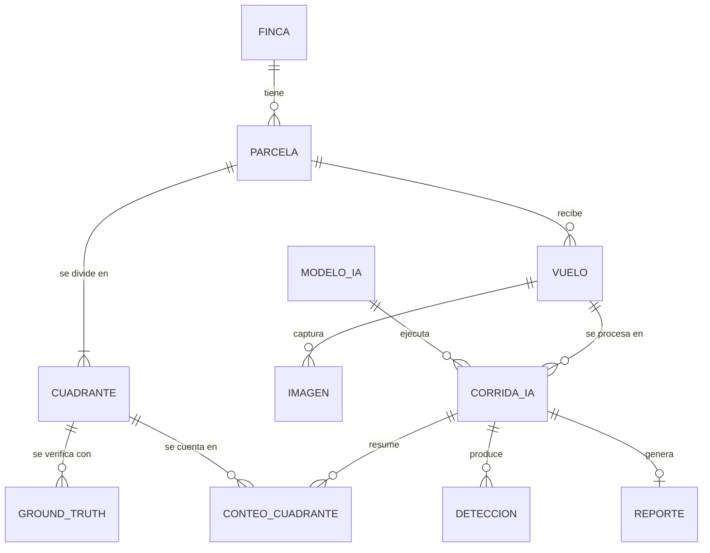

# AgroDron · Requerimientos de base de datos e inteligencia artificial

Versión 1.0 · 18 de noviembre de 2026 · Preparado para el Sprint 3 (Épica 4, 17–26/11)

Fuentes: actas de cierre de Sprint 1 y 2, SOW, kickoff, propuesta económica, roadmap, minutas 1–3 (carpeta *Proyecto Agrodron*) y el código de `github.com/Antoncard/agrodron.io`.

---

## 1. Dónde estamos

| Sprint | Periodo | Épicas | Estado según actas |
|---|---|---|---|
| 1 | 19–30/10 | 1 Captura en campo · 2 Infraestructura | Cerrado el 30/10 |
| 2 | 03–11/11 | 3 IA y visión computacional | Cerrado el 11/11, aprobado el 13/11 |
| 3 | 17–26/11 | 4 Visualización y reportes | **En curso** |

La Épica 4 empieza consultando "los datos del último vuelo" (tarea 4.1.1) y calculando el déficit (4.1.2). Para eso hacen falta una base de datos con resultados reales y un modelo de IA con métricas. Hoy ninguno de los dos está completo.

### Lo que dicen los documentos y lo que muestra el repo

| Tema | Documentos | Repo (HEAD `b326f54`) |
|---|---|---|
| Modelo de IA | "Modelo de visión artificial entrenado y validado" (acta Sprint 2) | No hay pesos, dataset etiquetado, script de entrenamiento ni métricas. `DetectorSimulado` proyecta las plantas del ground truth, por eso `contar` da **0,00 % de error en los 4 cuadrantes**. Prueba la geometría (georreferencia + fusión), no un modelo |
| Base de datos | "Diseño del esquema" (SOW, Sprint 1) y "Despliegue de RDS MySQL" (Sprint 3) | No existe. Solo CSV y `manifiesto.json` |
| Almacenamiento (Épica 2) | Repositorio y carga masiva, "cerradas" | `src/almacen/` no existe: el commit borró `almacen.py` y no creó la carpeta. **`import src` falla**, así que las pruebas, el CLI y el CI de GitHub fallan |
| Datos de calibración | Bitácora real (CA-01) | El panel muestra 18 satélites y HDOP 0,68 fijos en el simulador |
| Cobertura y cuadrantes | 100 % en 4 cuadrantes (CA-02) | `--rumbo` vale 45° por defecto, pero el panel sale con rumbo 0° y las fotos solo cuadran con 0° (100 %); al evaluar con 45° la cobertura cae a 71,29 %. Aun con 0°, 36 de 220 fotos quedan fuera del polígono. Las carpetas `fotos_sd/Q1..Q4` (83/50/45/50) no coinciden con el conteo por GPS del panel (48/48/44/44) |

### Inconsistencias entre documentos que conviene cerrar con el Product Owner

1. Fin del Sprint 2: 11/11 (SOW y acta de cierre), 12/11 (minuta 2) y 13/11 (minuta 3). El acta de cierre dice 11/11 y se aprobó el 13/11.
2. Roles: en las actas Santiago Cruz es **Product Owner** y Antonio Cardona **IA – Analista de datos**. El Acta de apertura v2 que redacté usa "Santiago, ingeniero de drones", "Antonio, automatización y validación" y deja el PO sin nombrar. Hay que alinearla.
3. Alcance del Sprint 1: el acta de apertura v2 dice solo Épica 1 (13 SP); el kickoff, la minuta 1 y el acta de cierre dicen Épicas 1 + 2 (80 h). La línea base real es la de las actas de cierre.
4. Meta de precisión: el acta de kickoff dice "concordancia mínima del 90 %"; la presentación dice "90 % o margen de error ≤ 5 %". Son metas distintas (90 % de concordancia admite 10 % de error). Propuesta en la sección 4.6.
5. Nube: el SOW y la propuesta usan AWS (S3, Lambda, EC2, RDS, API Gateway; USD 1.109,96/mes). El código se mantiene sin nube (decisión tuya), así que esta guía es neutral y deja una tabla de equivalencias en la sección 7.

---

## 2. Decisiones de arquitectura propuestas

| Decisión | Propuesta | Por qué |
|---|---|---|
| Motor de base de datos | **MySQL 8** (SQLite en desarrollo y pruebas) | El SOW dice RDS MySQL; así el diseño es compatible con lo firmado y corre local en Docker |
| Acceso a datos | SQLAlchemy 2 + Alembic (migraciones) | Un solo modelo para SQLite y MySQL; el esquema queda versionado |
| Modelo de IA | **YOLO** (Ultralytics, YOLOv8n/s) con tiling y NMS | Es lo que dice el SOW; corre en CPU para inferencia y en una GPU para entrenar |
| Servicio | FastAPI (`/api/v1`) + panel estático | Ya existe un panel en `public/`; solo hay que alimentarlo con la API |
| Ejecución | `docker compose` con `db`, `api`, `worker` | Reproducible en cualquier equipo, sin cuentas de nube |
| Almacenamiento de fotos | Carpeta local `raw/<finca>/<lote>/<fecha>/` + MD5 | Ya está diseñado; la BD guarda rutas y hashes, no las imágenes |

---

## 3. Requerimientos de base de datos

### 3.1 Modelo de datos



| Tabla | Campos principales | Notas |
|---|---|---|
| `finca` | id, nombre, vereda, municipio | "Vereda La Cabaña, Manizales" |
| `parcela` | id, finca_id, nombre, lat_origen, lon_origen, ancho_m, largo_m, rumbo_deg, plantas_esperadas | Piloto: 100×100 m, **2.500 esperadas** |
| `cuadrante` | id, parcela_id, codigo (Q1–Q4), esperadas | Q1 NO, Q2 NE, Q3 SE, Q4 SO; 625 esperadas cada uno |
| `vuelo` | id, parcela_id, fecha, altura_m, gsd_cm_px, solape_frontal, solape_lateral, velocidad_ms, satelites, hdop, obturacion, estado | Registra la bitácora real del CA-01 |
| `imagen` | id, vuelo_id, archivo, ruta, md5, bytes, ancho_px, alto_px, nitidez, lat, lon, dictamen, motivo, cuadrante_id | Una fila por foto, aceptada o rechazada |
| `modelo_ia` | id, nombre, version, arquitectura, ruta_pesos, sha256, dataset_version, fecha_entrenamiento, metricas_json | Cada corrida apunta al modelo exacto que se usó |
| `corrida_ia` | id, vuelo_id, modelo_id, inicio, fin, umbral_confianza, radio_fusion_m, estado, total_detectadas | Una ejecución del modelo sobre un vuelo |
| `deteccion` | id, corrida_id, imagen_id, x_m, y_m, lat, lon, confianza, cuadrante_id, fusionada | Planta detectada ya georreferenciada |
| `conteo_cuadrante` | corrida_id, cuadrante_id, detectadas, esperadas, deficit, error_vs_gt_pct | Lo que consulta el dashboard |
| `ground_truth` | id, cuadrante_id, fecha, contadas, responsable | 598 / 584 / 579 / 591 = **2.352** |
| `reporte` | id, corrida_id, resumen_json, ruta_pdf, creado | Salida de la Épica 4 |

### 3.2 Requerimientos funcionales

| ID | Requerimiento | Criterio de aceptación |
|---|---|---|
| BD-01 | Guardar el vuelo con su bitácora de calibración (satélites, HDOP, obturación) | Un vuelo sin satélites ≥ 16 u obturación ≤ 1/1000 s queda con `estado = RECHAZADO` |
| BD-02 | Registrar cada imagen con MD5, dictamen y cuadrante calculado por GPS | Las 228 fotos del plan oficial quedan con una fila; la suma de aceptadas y rechazadas es 228 |
| BD-03 | Registrar el modelo de IA con versión, hash y métricas | No se puede crear una `corrida_ia` sin `modelo_id` |
| BD-04 | Guardar cada detección georreferenciada | Un conteo se puede reconstruir sumando `deteccion` por cuadrante |
| BD-05 | Guardar el conteo manual (ground truth) por cuadrante | Se carga desde `planilla_conteo.csv` sin duplicar si se repite |
| BD-06 | Calcular déficit y error por cuadrante | `deficit = esperadas − detectadas`; ejemplo: 625 − 598 = 27 |
| BD-07 | Consultar el **último vuelo** de una parcela con su última corrida | Una sola consulta devuelve resumen total y por cuadrante en menos de 200 ms |
| BD-08 | Guardar el reporte generado | El reporte enlaza a la corrida que lo originó |
| BD-09 | Importar datos existentes | Script que lee `reporte_qa.csv`, `planilla_conteo.csv` y `manifiesto.json` y los inserta |

### 3.3 Requerimientos no funcionales

| ID | Requerimiento |
|---|---|
| BD-N1 | Esquema versionado con Alembic: `alembic upgrade head` crea todo desde cero |
| BD-N2 | Integridad: llaves foráneas, `UNIQUE (vuelo_id, archivo)` en imágenes y `UNIQUE (corrida_id, cuadrante_id)` en conteos |
| BD-N3 | Índices en `imagen(vuelo_id)`, `deteccion(corrida_id, cuadrante_id)` y `vuelo(parcela_id, fecha)` |
| BD-N4 | Cargas en transacción: si falla una foto, no queda un vuelo a medias |
| BD-N5 | Credenciales por variables de entorno; nunca dentro del repositorio |
| BD-N6 | Respaldo diario con `mysqldump` (o copia del archivo SQLite) y prueba de restauración |
| BD-N7 | Datos de prueba (`seed`) con el piloto: 1 finca, 1 parcela, 4 cuadrantes, el ground truth de 2.352 |
| BD-N8 | Pruebas automáticas contra SQLite en el CI de GitHub; una corrida opcional contra MySQL en Docker |

### 3.4 Consultas que necesita la Épica 4

```sql
-- Último vuelo de la parcela
SELECT id FROM vuelo WHERE parcela_id = :p ORDER BY fecha DESC, id DESC LIMIT 1;

-- Resumen por cuadrante de la última corrida del vuelo
SELECT c.codigo, cc.esperadas, cc.detectadas, cc.deficit,
       ROUND(cc.deficit * 100.0 / cc.esperadas, 2) AS deficit_pct
FROM conteo_cuadrante cc
JOIN cuadrante c ON c.id = cc.cuadrante_id
WHERE cc.corrida_id = :corrida
ORDER BY c.codigo;
```

---

## 4. Requerimientos de inteligencia artificial

### 4.1 Dataset

| ID | Requerimiento |
|---|---|
| IA-01 | Etiquetar como mínimo **300 recortes de 640×640 px** que incluyan los cuatro cuadrantes, con sombra, suelo descubierto y maleza |
| IA-02 | Clases: `planta` y `maleza` (la maleza evita falsos positivos, como pide el SOW). Opcional: `planta_muerta` |
| IA-03 | Formato YOLO (`.txt` por imagen) y un `data.yaml` versionado |
| IA-04 | Partición **por foto, no por recorte**: 70 % entrenamiento, 15 % validación, 15 % prueba. Dos recortes de una misma foto nunca van a conjuntos distintos (hay solape de 80/75 %, cada punto sale en hasta ~20 fotos) |
| IA-05 | Registrar quién etiquetó y con qué herramienta (CVAT, Label Studio o Roboflow) |
| IA-06 | Las fotos de prueba no se usan para entrenar ni para ajustar umbrales |

### 4.2 Entrenamiento

| ID | Requerimiento |
|---|---|
| IA-07 | Script `entrenar.py` reproducible: semilla fija, hiperparámetros en un archivo de configuración y salida en `modelos/<version>/` |
| IA-08 | Arquitectura inicial YOLOv8n; subir a YOLOv8s si el recall en validación queda bajo la meta |
| IA-09 | Aumentos permitidos: giros 90°, brillo/contraste, ruido leve. No usar recortes que cambien la escala (el GSD es fijo en 0,938 cm/px) |
| IA-10 | Guardar con cada modelo: pesos, `sha256`, versión del dataset, curvas y `metricas.json` |
| IA-11 | Entrenar en una GPU (laboratorio, Colab o la EC2 del SOW); la inferencia debe correr también en CPU |

### 4.3 Inferencia sobre la parcela

| ID | Requerimiento |
|---|---|
| IA-12 | **Tiling**: recortes de 640 px con 20 % de solape. Una foto de 4000×3000 genera 48 recortes y un vuelo de 228 fotos, unos 10.900 |
| IA-13 | **NMS** dentro de cada foto para quitar duplicados entre recortes vecinos |
| IA-14 | Convertir cada detección de píxel a metros y a latitud/longitud (`ml/georef.py`) |
| IA-15 | **Fusión entre fotos**: cada planta se cuenta en la foto cuyo centro está más cerca (margen 0,05 m) y se eliminan duplicados en un radio de 0,6 m |
| IA-16 | Asignar cada planta a su cuadrante y guardar las detecciones en la BD (`deteccion`) |
| IA-17 | Procesar un vuelo de 228 fotos en menos de 30 minutos en CPU de 8 núcleos (meta; medir y ajustar) |
| IA-18 | Registrar la confianza por detección y el umbral usado (inicial: 0,25; se calibra en validación) |

### 4.4 Evaluación

| ID | Métrica | Cómo se mide |
|---|---|---|
| IA-19 | Precisión, recall y F1 de detección | Conjunto de prueba, IoU 0,5 |
| IA-20 | **Error de conteo por cuadrante** | `\|detectadas − ground_truth\| / ground_truth` frente a 598 / 584 / 579 / 591 |
| IA-21 | Error de conteo total | Frente a las 2.352 plantas vivas |
| IA-22 | Sesgo | Si el modelo cuenta de menos o de más en promedio (error con signo) |
| IA-23 | Sensibilidad al error GPS | Repetir el conteo con ruido de posición de 0,5 / 1 / 2 m (el espaciado entre plantas es de ~2 m, comparable con el GPS) |

### 4.5 Operación

| ID | Requerimiento |
|---|---|
| IA-24 | Una corrida guarda el modelo usado, parámetros, hora de inicio y fin |
| IA-25 | Si falla una foto, la corrida sigue y deja el error en el registro |
| IA-26 | Estado de la corrida visible en la API: `EN_COLA`, `PROCESANDO`, `LISTA`, `ERROR` |
| IA-27 | Nuevo modelo = nueva versión; los resultados anteriores no se sobrescriben |
| IA-28 | Licencia: Ultralytics YOLO es AGPL-3.0. Sirve para el prototipo académico; si algún día se comercializa hay que revisar la licencia o cambiar de detector |

### 4.6 Meta de precisión (a aprobar por el Product Owner)

Los documentos piden "≥ 90 % de concordancia" y "≤ 5 % de error" a la vez. Propuesta para dejar una sola regla:

| Semáforo | Error de conteo total | Error por cuadrante |
|---|---|---|
| Verde (aprobado) | ≤ 5 % | ≤ 10 % |
| Amarillo | ≤ 10 % | ≤ 15 % |
| Rojo | > 10 % | > 15 % |

Más un mínimo de **F1 ≥ 0,85** en el conjunto de prueba. Santiago Cruz decide los valores finales.

---

## 5. Requerimientos de API y panel (Épica 4)

| ID | Requerimiento |
|---|---|
| API-01 | `GET /api/v1/parcelas/{id}/ultimo-vuelo` devuelve resumen, déficit total y por cuadrante |
| API-02 | `GET /api/v1/vuelos/{id}/conteo` con detectadas, esperadas, déficit, error y semáforo |
| API-03 | `GET /api/v1/vuelos/{id}/detecciones.geojson` para el mapa de densidad y para QGIS |
| API-04 | `POST /api/v1/vuelos/{id}/procesar` encola una corrida y devuelve su estado |
| API-05 | `GET /api/v1/reportes/{id}.pdf` con el resumen para el agricultor |
| API-06 | Autenticación por clave de API (`x-api-key`), comparada con `hmac.compare_digest` |
| UI-01 | Tarjeta principal: "Esperadas 2.500 · Estimadas N · Déficit D (X %)" con el ejemplo del roadmap |
| UI-02 | Mapa de densidad por celdas de 10×10 m con los cuadrantes Q1–Q4 señalados |
| UI-03 | Tabla por cuadrante con semáforo y una frase en lenguaje llano ("En el cuadrante Q3 faltan unas 46 plantas") |
| UI-04 | Prueba con usuarios (tarea 4.2.2): guion de 5 preguntas y registro de si el agricultor entendió el déficit y dónde está |

---

## 6. Ideas nuevas, ordenadas por valor frente a esfuerzo

| # | Idea | Qué aporta | Esfuerzo |
|---|---|---|---|
| 1 | **Lista de huecos para resiembra** | Exporta las coordenadas donde la malla esperada de siembra no tiene planta (CSV/GPX para el celular). Convierte el déficit en una acción concreta | Bajo |
| 2 | **Mapa de calor de densidad** | Celdas de 10×10 m coloreadas por plantas/ha; muestra las zonas críticas de un vistazo | Bajo |
| 3 | **Corrección de sesgo con el ground truth** | Si el modelo cuenta 2 % de menos en promedio, se corrige y se reporta un intervalo ("2.352 ± 40") en vez de un número seco | Medio |
| 4 | **Reporte para el agricultor en PDF de una página** | Tres cifras, un mapa y una recomendación; lenguaje llano | Bajo |
| 5 | **Aviso por Telegram** | El SOW lo contempla "según viabilidad". Un bot que responda con el resumen del último vuelo no necesita salida a internet desde el servidor si responde en el webhook | Medio |
| 6 | **Comparación entre vuelos** | Serie en el tiempo: déficit del mes anterior vs actual por cuadrante (la tabla `vuelo` ya lo permite) | Bajo |
| 7 | **Revisión de baja confianza** | Pantalla con las detecciones dudosas (confianza 0,25–0,50); lo que se corrige alimenta el siguiente entrenamiento | Medio |
| 8 | **Re-vuelo solo de huecos** | Si el QA rechaza fotos y la cobertura baja de 100 %, el sistema genera una ruta KML únicamente para las zonas sin cobertura | Medio |
| 9 | **Lista de verificación pre-vuelo** | Viento, lluvia, satélites, HDOP, obturación y batería antes de despegar; queda guardada en `vuelo` | Bajo |
| 10 | **Panel que funciona sin internet** | Leaflet y fuentes ya van locales; falta un modo "solo lectura" desde un USB para entregarlo a la finca | Bajo |
| 11 | **Clase `maleza` y `planta_muerta`** | Separa el déficit por falta de siembra del déficit por plantas muertas | Medio |
| 12 | **Dataset versionado con DVC** | Cada modelo apunta a la versión exacta del dataset usada | Medio |
| 13 | **Evaluación de costos neutral** | Comparar el costo de la nube del SOW (USD 1.109,96/mes) con una máquina local para el piloto de 1 ha | Bajo |

Las ideas 1, 2, 4 y 6 caben en el Sprint 3 sin mover el alcance. El resto queda como backlog para el Product Owner.

---

## 7. Equivalencia con la propuesta (AWS) para los documentos de clase

| Componente neutral | Servicio en el SOW |
|---|---|
| Carpeta local `raw/…` + MD5 | Amazon S3 |
| Worker con cola en la BD | AWS Lambda |
| Máquina con GPU para entrenar | Amazon EC2 `g4dn.xlarge` |
| MySQL 8 en Docker | Amazon RDS MySQL |
| FastAPI | Amazon API Gateway + Lambda |

El esquema de la sección 3 funciona igual en RDS MySQL; migrar es cambiar la cadena de conexión.

---

## 8. Plan para cerrar el Sprint 3 (17–26/11)

| Día | Trabajo | Resultado verificable |
|---|---|---|
| Mié 18 | Reparar `src/almacen/` y el CI; decidir la meta de precisión con el PO | `python -m unittest` en verde; CI verde |
| Jue 19 | Esquema SQLAlchemy + Alembic + seed del piloto (BD-01 a BD-05, BD-N1 a N3, N7) | `alembic upgrade head` y consulta del último vuelo |
| Vie 20 | Importador de CSV existentes; cálculo de déficit (BD-06, BD-07, BD-09) | 625 − 598 = 27 en Q1, reproducido por prueba |
| Lun 23 | Evidencia real de IA: dataset etiquetado, entrenamiento, `metricas.json` y conteo contra el ground truth (IA-01 a IA-11, IA-19 a IA-22) | Tabla de error por cuadrante **con el modelo real** |
| Mar 24 | API y panel conectados a la BD (API-01 a API-04, UI-01 a UI-03) | El panel muestra la última corrida, no datos de ejemplo |
| Mié 25 | Prueba con usuarios y ajustes (UI-04); ideas 1, 2 y 4 | Guion aplicado y resultados anotados |
| Jue 26 | Manual, acta de cierre y demo | Entrega |

### Pendiente inmediato (antes de seguir con funciones nuevas)

1. Restaurar el almacenamiento (`src/almacen/`) y volver a poner las pruebas en verde.
2. Subir al repo la evidencia del Sprint 2: dataset etiquetado, script de entrenamiento, modelo y métricas. Si ya existen fuera del repo, indicar dónde están; sin eso, el panel solo muestra un conteo simulado.
3. Cambiar los datos fijos del simulador (18 satélites, HDOP 0,68, fecha 2026-10-22) por la bitácora real del vuelo.
4. Corregir el rumbo en el simulador (el valor de `--rumbo` no llega a la posición de las fotos) y hacer que las carpetas `Q1..Q4` y el conteo por GPS usen la misma regla de cuadrantes.
5. Alinear el Acta de apertura v2 con las actas de cierre (roles y alcance del Sprint 1).
